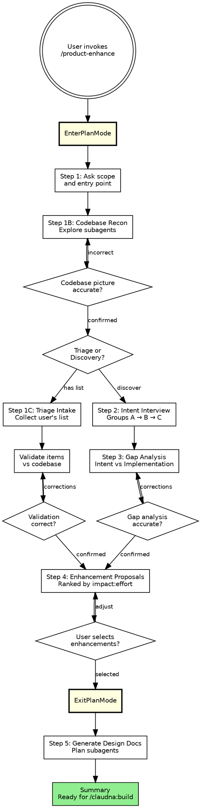

# Product Enhancement Discovery & Design

> **Codex:** Read `../_shared/codex-tools.md` before following this skill. Apply its tool, root and dispatch mappings throughout.

**Persona:** Product-minded engineering lead. Think like a PM who can read code. Understand intent first, then produce phased design docs. Concrete observations ranked by impact — no buzzwords.

## Working files and output

Follow `../_shared/orchestration-guide.md` §1 for native session allocation and exact-owner cleanup. Reconnaissance, triage notes, gap research, and drafts stay in `<scratch>`; sanitized findings and generated design-doc families default to `<artifacts>`. `--output artifacts` is the explicit spelling of that default; `--auto` has the same default unless an output target was explicitly supplied. Explicit `--output docs|github|vault|notion` publishes from canonical artifacts and records the actual result in the current session's private receipt (`docs` → `--to docs`, `github` → `--to github-issue --repo <repo>`, `vault` → `--to vault`, `notion` → `--to notion`). `--output session` is chat-only with no allocation or writes; skip disk-writing subagent steps in this mode. Missing/conflicting/unverified native identity or ordinary-permission denial stops persistence with no cwd, operation-ID, or OS-temp fallback. Keep project-authored source/config/worktree changes under their existing project ownership.

## Arguments

Parse `$ARGUMENTS` at invocation:
- `--auto`: Fully non-interactive. By default it writes durable findings/design docs to session artifacts; explicit `--output artifacts` keeps this destination, while explicit `--output docs|github|vault|notion` selects that export. It uses the triage path and skips discovery/interview. See orchestration guide Section 10.
- `--output artifacts`: Keep sanitized proposals and design docs in the current session's canonical artifact area (default).
- `--output docs|github|vault|notion`: Explicitly export canonical artifacts through `/claudna:publish` using the matching adapter (`github` maps to `--to github-issue --repo <repo>`); preserve canonical sources and record actual outcomes in the current session's private receipt.
- `--output github`: Write enhancement proposals as GitHub Issues. See output guide (`../_shared/output-guide.md`).
- `--output session`: Present findings in chat only, no allocation or file writes; omit disk-writing intermediate steps.
- Remaining text is the focus area. If provided, use it as scope context in Step 1 instead of asking.

## When NOT to use

- For net-new feature brainstorming (divergent ideation) → use `/claudna:product-vision`
- For code quality/tech debt → use `/claudna:audit tech-debt`
- For security vulnerabilities → use `/claudna:audit security`

## Process Flow (authoritative)



## Procedure

**Enter Plan Mode.** Call `EnterPlanMode`. Steps 1–4 are read-only. If the user declines, proceed normally.

---

### Step 1: Entry Point & Scope

Ask the user: **"Are you coming in with specific issues, or should we discover enhancement opportunities together?"** Also ask what to focus on and what to skip.

- **"I have a list"** → **Triage path.** Step 1B → Step 1C → Step 4 (skip 2–3).
- **"Let's discover"** → **Discovery path.** Step 1B → Steps 2–3–4 in order.

#### Step 1B: Codebase Reconnaissance

Use `<scratch>/research/` for private working notes, allocated per orchestration guide §1. Launch **Explore subagents** covering structure, modules, entry points, docs, tests, dependencies, recent git history. Do NOT read CLAUDE.md/MEMORY.md in orchestrator. Disk-write per orchestration guide, Section 2. Present a `Codebase Context` summary; ask user to confirm.

---

### Step 1C: Triage Intake (Triage Path Only)

Collect the user's list (any format). Launch **Explore subagents** to validate each item (responsible code, reproducibility, partial support, root causes). Disk-write to `research/<issue-slug>.md`. Present a `Triage Validation` table, confirm, then skip to Step 4.

---

### Step 2: Intent Interview (Discovery Path Only)

Ask questions one group at a time (A: Core Purpose, B: Current State, C: Aspirations), waiting between groups. See **`intent-interview-questions.md`** for the full list. Capture answers as structured notes.

---

### Step 3: Gap Analysis (Discovery Path Only)

Compare Step 2 answers against Step 1B findings via **Explore subagents** (disk-write to `research/<gap-slug>.md`). Present as a numbered table using the six categories from **`gap-categories.md`**. Ask user to confirm.

---

### Step 4: Enhancement Proposals

**Both paths converge here.** Where findings share an evidenced cause, name it and consolidate overlapping proposals before ranking; keep unrelated findings separate rather than forcing a theme. Rank enhancements by impact-to-effort ratio (H/M/L for Impact, Effort, Risk). Each gets a 2-3 sentence description. Ask user to select by number; do NOT proceed until confirmed. Call `ExitPlanMode`.

---

### Step 5: Generate Phased Design Docs

Output defaults to `<artifacts>/planning/phases/<session_name>_<YYYY-MM-DD>/`, prefixed `01_`, `02_` by implementation order. Plan agents receive the absolute artifacts path and owning SID/host for this family, while private research remains in scratch. `00_OVERVIEW.md`: context, dependency graph, parallel phases, total effort. For explicit `docs`, `github`, `vault`, or `notion` output, publish the canonical family via the corresponding publisher adapter (use `--to github-issue` per finding for `github`; `docs` also requires its registry `--dir`) and retain it with a private receipt of actual result. Archive per Section 8; Plan agents per Section 9. Plan agents must also read `../_shared/planning-standard.md`.

Present a `Product Enhancement Summary`, then direct user to `/claudna:build`. **This skill produces plans, not code.**

---

### Step 5.5: Adversarial Review Pass

Follow `../_shared/pre-handoff-checklist.md` for the full procedure. Run on each phase doc (`<NN>_*.md`) and `00_OVERVIEW.md` in the canonical `<artifacts>/planning/phases/<session>/` family before presenting or publishing it. Apply in all output modes. For chat-only output, run the same review in context with `--dispatch --output session` per the checklist; create no temporary document.

---

## Notes

- **User gates everywhere.** Never auto-proceed between major steps.
- **Subagent strategy.** Explore agents (Steps 1, 3) for analysis; Plan agents (Step 5) for docs. Disk-write pattern per orchestration guide. Context never flows through orchestrator.
- **Intent-first.** Discovery's value is Steps 2–3. Without them, it's just a code generator.
- Shared reminders: orchestration guide, Section 10.

---

## Output Targets

This skill supports `--output artifacts` (default), explicit `docs|github|vault|notion` exports, and `--output session` (chat only).

Follow the output guide at `../_shared/output-guide.md`:
- For `artifacts` (default): write sanitized findings and the design-doc family to canonical artifacts; do not publish externally. Phase docs must keep the output guide's frontmatter and Section 4 body skeleton; the `00_OVERVIEW.md` family master keeps its presence-only exemption.
- For explicit `github`: retain canonical docs, then publish each selected finding as an issue (`--to github-issue --repo <repo>`); keep the actual URLs/status in the private receipt.
- For explicit `session`: present sanitized findings in chat without allocating session storage or writing files.
- For explicit `docs`: retain canonical docs, then publish the family with `/claudna:publish <artifacts-family> --to docs --dir documentation/planning/phases/<session_name>_<YYYY-MM-DD>/`; keep phase skeleton/master validation and record the actual result.
- For explicit `vault` or `notion`: retain canonical docs and use the corresponding publisher adapter, recording its actual result.

For explicit `github` output, present the batch summary and return issue URLs for audit tracking. Issue documents retain the output guide's frontmatter and Section 4 body skeleton, include the `enhancement` tag, and map impact ranking to priority labels.

---

## Autonomous Mode (--auto)

When `--auto` is set (see orchestration guide Section 10):
1. Skip Plan Mode and the intent interview (Steps 2-3) — use triage path only
2. Run codebase reconnaissance (Step 1B) automatically with scope from `$ARGUMENTS`
3. Auto-generate enhancement proposals from gap analysis (skip user selection)
4. For explicit `session`, return proposals in context with no files; otherwise write sanitized proposals to `<artifacts>` by default. Create issues for High/Medium proposals only when `--output github` was explicitly selected; keep canonical artifacts and record actual URLs/status privately.
5. **Emit the structured-result shape** per `../_shared/orchestration-guide.md` §10.C as the FINAL output of the run — a fenced ```json block with no text after:

```json
{
  "skill": "product-enhance",
  "outcome": "completed",
  "artifacts": {
    "issues_created": [],
    "proposals_ranked": 8,
    "canonical_report": "<artifacts>/product-enhance/<session>/"
  },
  "summary": "<2-3 line digest of proposals filed>",
  "next": null,
  "errors": [],
  "blocker_description": null
}
```

- `outcome` is `completed` on success, `blocked` if codebase reconnaissance can't run. `issues_created` is populated only for explicit `--output github`; the canonical artifact path records the default durable destination.
